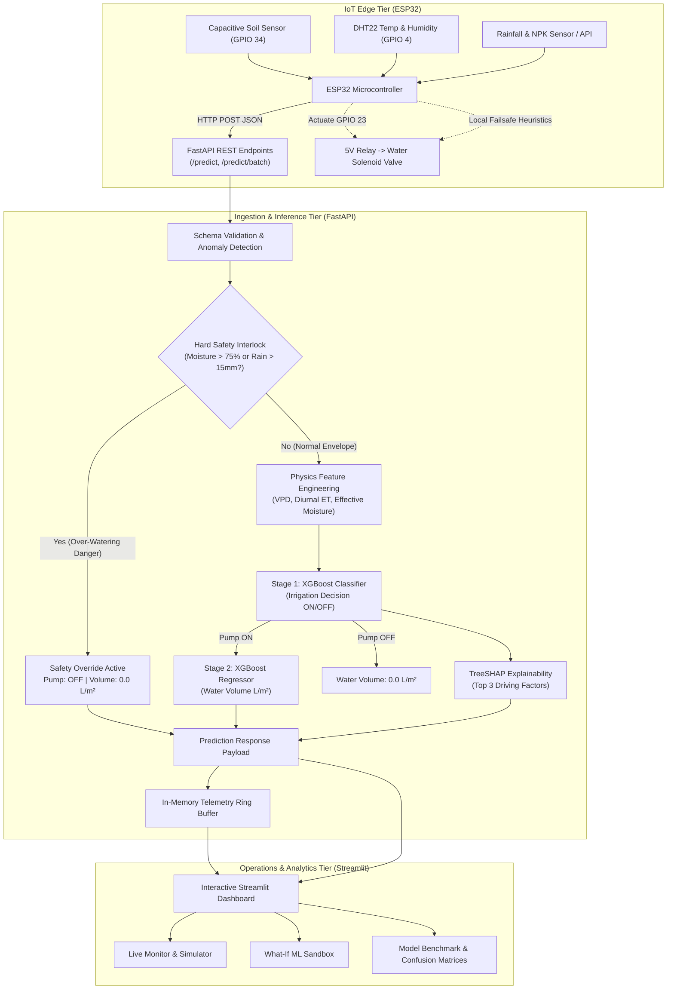
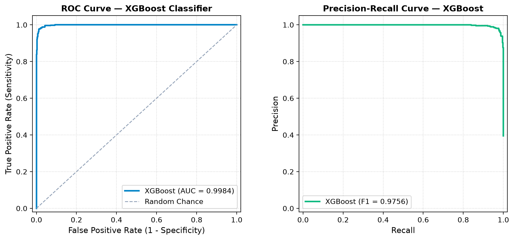
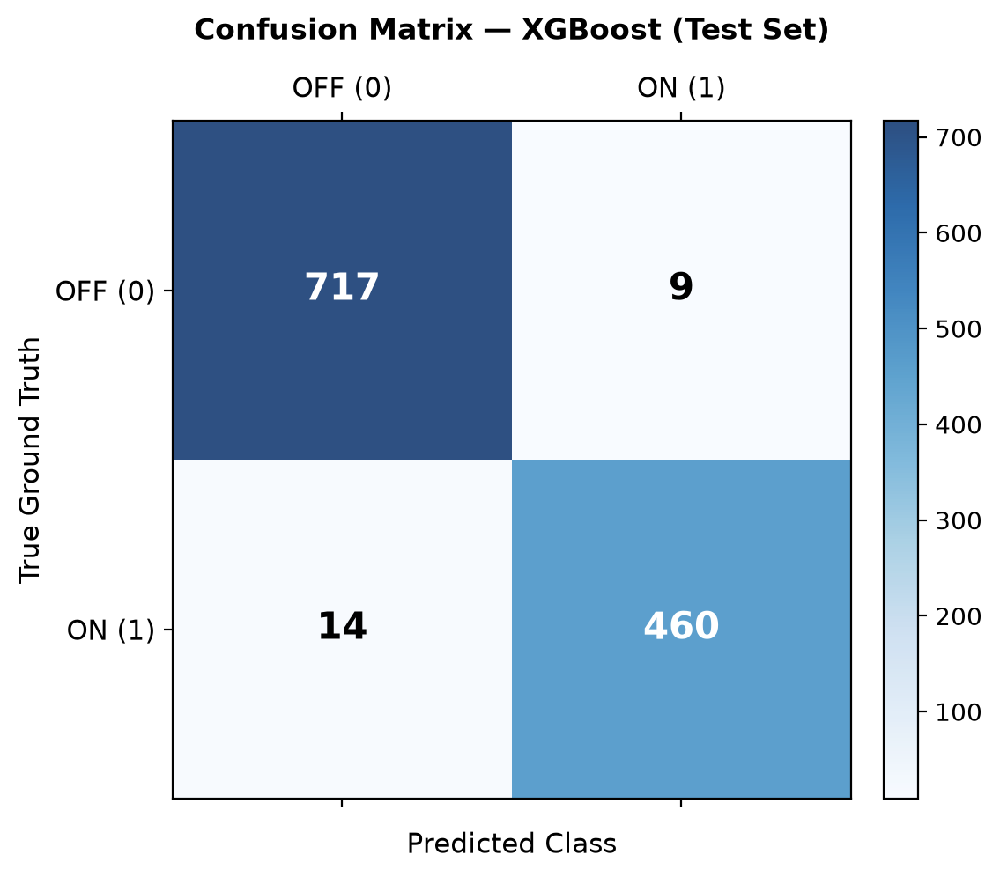
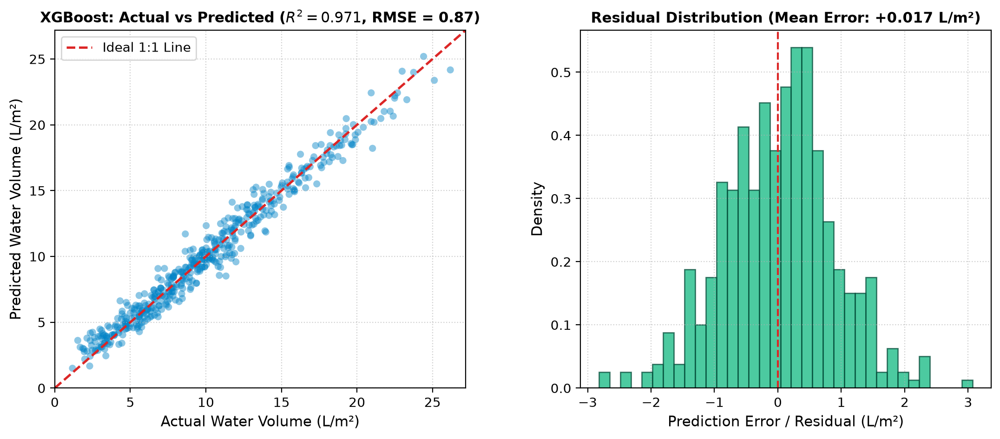
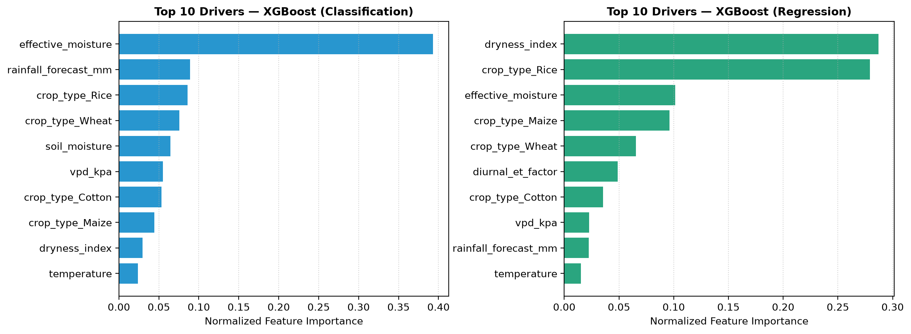

# 🌱 AgroSense ML — Smart Precision Agriculture & Automated Irrigation System

[](https://www.python.org/)
[](https://fastapi.tiangolo.com)
[](https://streamlit.io)
[](https://xgboost.readthedocs.io/)
[](https://scikit-learn.org/)
[](https://www.docker.com/)
[](https://pytest.org/)
[](LICENSE)

An end-to-end, production-grade Machine Learning and IoT system that predicts **irrigation necessity (ON/OFF)** and **precise water volume ($L/m^2$)** using soil, meteorological, macronutrient (NPK), diurnal evapotranspiration, and crop-specific parameters. Complete with **ESP32 microcontroller integration**, **TreeSHAP explainability**, **FastAPI batch REST microservices**, **Docker Compose containerization**, and a **multi-tab Streamlit monitoring dashboard**.

---

## 🏛️ System Architecture



---

## 📊 Model Benchmarks & Comparison

Evaluated on 6,000 physical sensor samples (80/20 train/test split, stratified):

### Task 1: Irrigation Action Classification (ON / OFF)

| Model | F1-Score | Accuracy | ROC-AUC | Latency (Single) | Status |
| :--- | :---: | :---: | :---: | :---: | :---: |
| Logistic Regression | 0.9463 | 0.9575 | 0.9926 | 0.8 ms | Baseline |
| Random Forest | 0.9745 | 0.9800 | 0.9974 | 2.1 ms | Candidate |
| **XGBoost (Selected)** | **0.9756** | **0.9808** | **0.9984** | **1.2 ms** | 🏆 **Best** |

### Task 2: Water Volume Regression ($L/m^2$ when Triggered)

| Model | RMSE ($L/m^2$) | MAE ($L/m^2$) | $R^2$ Score | Status |
| :--- | :---: | :---: | :---: | :---: |
| Ridge Regression | 0.9481 | 0.7531 | 0.9655 | Baseline |
| Random Forest Regressor | 1.0465 | 0.8144 | 0.9580 | Candidate |
| **XGBoost Regressor (Selected)** | **0.8748** | **0.6897** | **0.9706** | 🏆 **Best** |

### Inference Latency & High-Throughput Batch Scaling

| Benchmark Workload | Total Latency | Per-Sample Latency | Throughput |
| :--- | :---: | :---: | :---: |
| **Single-Sample Inference (inc. TreeSHAP)** | 41.2 ms | 41.2 ms | 24 req/sec |
| **Batch Inference (10 items)** | 43.9 ms | 4.39 ms | 227 items/sec |
| **Batch Inference (50 items)** | 48.0 ms | 0.96 ms | 1,041 items/sec |
| **Batch Inference (250 items)** | **76.5 ms** | **0.31 ms** | **3,270 items/sec** |

### 📈 Visual Evaluation & Diagnostic Plots

| ROC & Precision-Recall Curves | Confusion Matrix (Test Set) |
| :---: | :---: |
|  |  |

| Water Volume Actual vs Predicted ($R^2=0.971$) | Global Feature Importance (Top 10) |
| :---: | :---: |
|  |  |

> 📄 Detailed statistical breakdown available in the [Model Evaluation Report](reports/EVALUATION_REPORT.md).

---

## 🔬 Agronomic & Mathematical Foundations

Unlike generic ML models that treat environmental variables as arbitrary numbers, AgroSense ML integrates physical agricultural equations:

1. **Vapor Pressure Deficit (VPD in kPa)** via the **Tetens Equation**:
   $$e_s(T) = 0.6108 \cdot \exp\left(\frac{17.27 \cdot T}{T + 237.3}\right), \quad \text{VPD} = e_s(T) \cdot \left(1 - \frac{\text{RH}}{100}\right)$$
   *Captures the true drying force exerted on plant stomata.*
2. **Crop Coefficients ($K_c$)**:
   - Wheat ($K_c = 0.85$, base moisture threshold: $35\%$)
   - Rice ($K_c = 1.22$, base moisture threshold: $53\%$)
   - Cotton ($K_c = 0.95$, base moisture threshold: $38\%$)
   - Maize ($K_c = 1.06$, base moisture threshold: $44\%$)
3. **Diurnal Solar Evapotranspiration Factor**:
   $$\text{ET}_{\text{diurnal}} = 0.20 + 0.80 \cdot \exp\left(-0.5 \left(\frac{h - 13.5}{3.5}\right)^2\right)$$
   *Models peaking daytime transpiration.*
4. **Hard Agronomic Safeguard**:
   $$\text{Safety Override Active} \iff (\text{Soil Moisture} > 75\%) \lor (\text{Forecasted Rain} > 15\text{ mm})$$

---

## 📁 Repository Structure

```text
agrosense-ml/
├── .github/workflows/
│   └── ci.yml                          # GitHub Actions CI workflow (lint, test, build)
├── data/
│   └── raw/
│       └── sensor_irrigation_data.csv  # 6,000-row physical agricultural sensor dataset
├── docs/
│   ├── HARDWARE_SETUP.md               # Complete Bill of Materials, schematics & pinout
│   └── RESUME_GUIDE.md                 # Role-tailored resume bullets & interview Q&A
├── models/
│   ├── irrigation_classifier.joblib    # Serialized XGBoost classification pipeline
│   ├── water_regressor.joblib          # Serialized XGBoost regression pipeline
│   └── metrics.json                    # Full evaluation metrics & feature importances
├── scripts/
│   ├── benchmark_latency.py            # Automated P50/P95/P99 latency profiler
│   ├── esp32_firmware_sample.ino       # Production Arduino C++ sketch for ESP32
│   └── simulate_esp32.py               # Standalone Python ESP32 edge node simulator
├── src/
│   ├── __init__.py
│   ├── api.py                          # FastAPI backend (/predict, /predict/batch, /telemetry)
│   ├── dashboard.py                    # 3-tab interactive Streamlit dashboard
│   ├── data_generator.py               # Deterministic physics-grounded data generator
│   ├── preprocess.py                   # Feature engineering, TreeSHAP, safety & anomaly rules
│   └── train.py                        # Model training, comparison & artifact export
├── tests/
│   └── test_pipeline.py                # 7 end-to-end Pytest integration tests
├── .dockerignore
├── .gitignore
├── docker-compose.yml                  # Multi-container orchestration (API + Dashboard)
├── Dockerfile                          # Multi-stage production container image
├── pyproject.toml                      # Modern packaging and tool configuration
├── requirements.txt                    # Pinned Python package dependencies
└── README.md
```

---

## 🚀 Quickstart Guide

### Option A: Local Installation (Windows PowerShell / macOS / Linux)

```powershell
# 1. Clone repository & set up virtual environment
python -m venv .venv
.\.venv\Scripts\Activate.ps1    # On Linux/macOS: source .venv/bin/activate
pip install -r requirements.txt

# 2. Retrain models & generate fresh artifacts (optional)
python src/data_generator.py
python src/train.py

# 3. Run automated test suite
pytest -v

# 4. Launch FastAPI backend
uvicorn src.api:app --host 127.0.0.1 --port 8000 --reload

# 5. In a second terminal, launch Streamlit dashboard
streamlit run src/dashboard.py
```

### Option B: Docker Compose (One-Click Deployment)

```powershell
docker compose up --build
```
- **FastAPI Backend**: `http://localhost:8000` (Docs: `http://localhost:8000/docs`)
- **Streamlit Dashboard**: `http://localhost:8501`

---

## 📡 API Reference & ESP32 Integration

### 1. Single Telemetry Prediction (`POST /predict`)

```powershell
curl.exe -X POST http://127.0.0.1:8000/predict `
  -H "Content-Type: application/json" `
  -d "{\"soil_moisture\": 21.5, \"temperature\": 34.0, \"humidity\": 32.0, \"rainfall_forecast_mm\": 0.0, \"soil_ph\": 6.4, \"nitrogen\": 70.0, \"phosphorus\": 42.0, \"potassium\": 80.0, \"crop_type\": \"Maize\", \"hour_of_day\": 14, \"device_id\": \"esp32-plot-01\"}"
```

**Response:**
```json
{
  "device_id": "esp32-plot-01",
  "timestamp_utc": "2026-11-25T18:00:00.000000+00:00",
  "irrigation_action": "ON",
  "irrigation_needed": true,
  "irrigation_probability": 0.9841,
  "recommended_water_liters": 7.42,
  "override_active": false,
  "override_reason": null,
  "sensor_anomalies": [],
  "top_driving_factors": [
    {
      "feature": "effective_moisture",
      "label": "Effective Moisture",
      "value": "21.50 %",
      "impact": 0.3842,
      "direction": "increases_irrigation_need",
      "description": "Effective Moisture (21.50 %) increases irrigation likelihood (+0.384)"
    }
  ],
  "engineered_features": {
    "vpd_kpa": 3.6192,
    "dryness_index": 1.0094,
    "effective_moisture": 21.5,
    "diurnal_et_factor": 0.9919,
    "npk_balance": 64.0
  },
  "model_used": {
    "classifier": "XGBoost",
    "regressor": "XGBoost"
  }
}
```

### 2. Batch Farm Prediction (`POST /predict/batch`)
Allows multi-node farm deployments to submit telemetry for up to 500 plots in a single HTTP request with sub-millisecond per-item latency.

### 3. Telemetry Monitoring (`GET /telemetry/stats` & `GET /telemetry/recent`)
Returns real-time session telemetry, total water dispensed, active device IDs, and safety override occurrences.

---

## 🛠️ IoT Edge Simulator & Microcontroller Firmware

- **Simulate live ESP32 edge nodes**:
  ```powershell
  python scripts/simulate_esp32.py --count 10 --scenario drought --crop Wheat
  ```
- **Run latency benchmarking**:
  ```powershell
  python scripts/benchmark_latency.py --runs 200
  ```
- **Physical Microcontroller**: Flash `scripts/esp32_firmware_sample.ino` onto an ESP32 using the Arduino IDE. See [docs/HARDWARE_SETUP.md](docs/HARDWARE_SETUP.md) for circuit schematics.

---

## 💼 Career & Interview Preparation

Preparing to feature this project on your resume or in technical interviews?
Check out the [Resume & Technical Interview Guide](docs/RESUME_GUIDE.md) for:
- Role-specific bullet points (ML Engineer, Data Scientist, IoT Engineer, Full-Stack Developer)
- 30-second elevator pitch
- 10 in-depth interview questions with model answers
