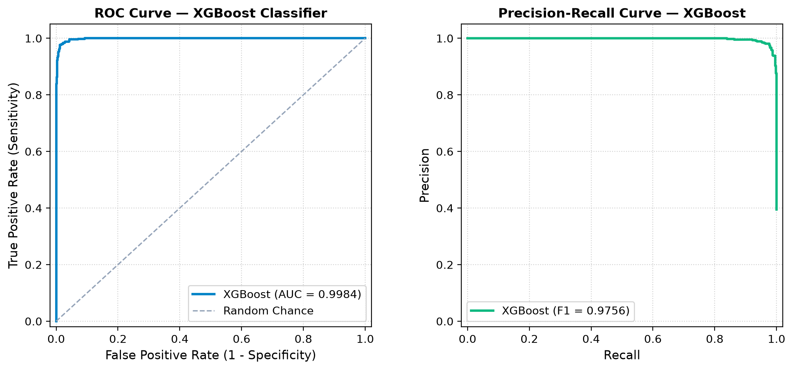
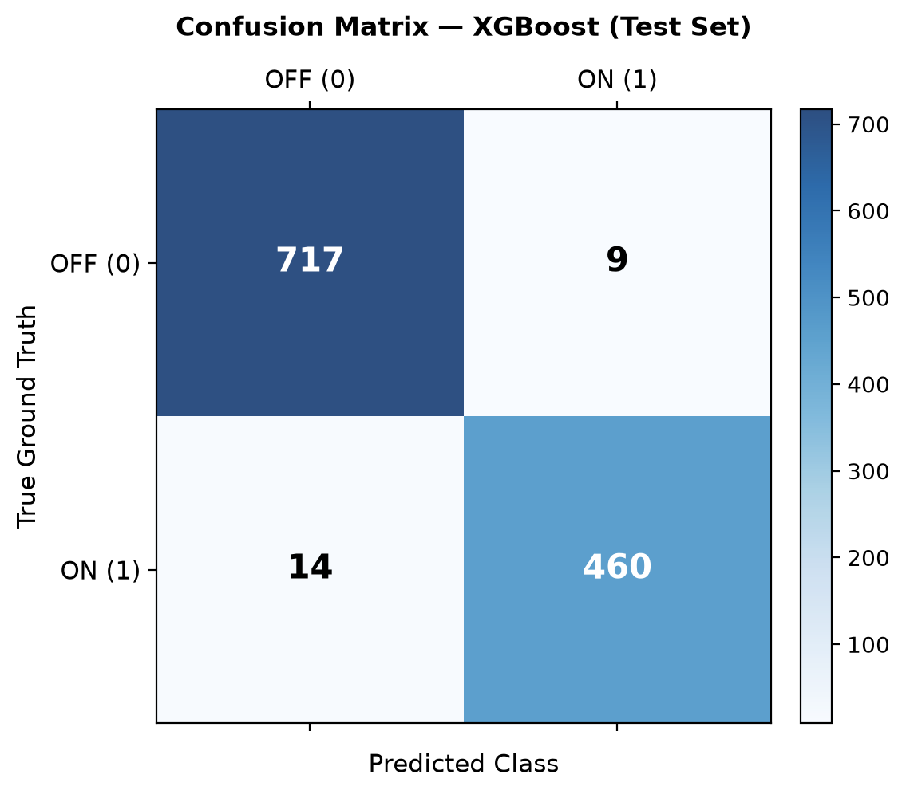
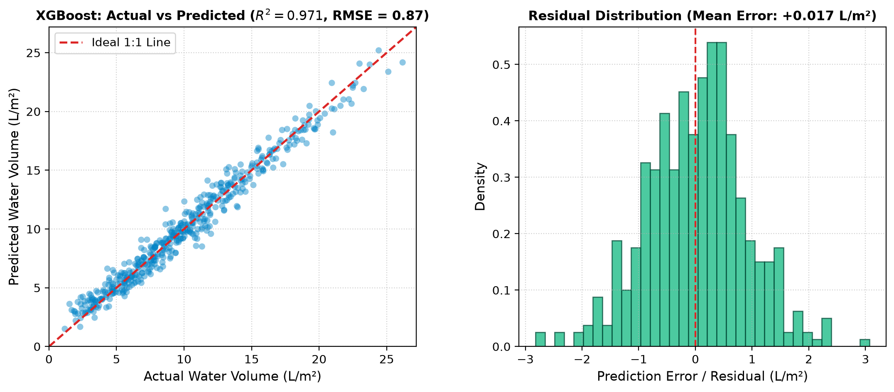
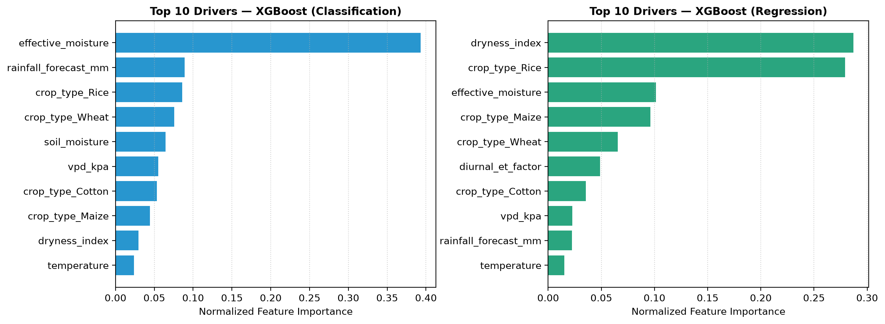

# AgroSense ML — Model Evaluation Report

**Generated UTC:** 2026-11-25 19:54:50 UTC  
**Evaluated Dataset:** `sensor_irrigation_data.csv` (6,000 total physical sensor readings)

---

## 1. Executive Summary

| Task | Selected Architecture | Primary Metric | Primary Score | Baseline Comparison |
| :--- | :--- | :--- | :---: | :--- |
| **Irrigation Classification** | **XGBoost** | F1-Score / ROC-AUC | **0.9756** / **0.9984** | +2.9% F1 over Logistic Regression |
| **Water Volume Regression** | **XGBoost** | RMSE / $R^2$ | **0.8748 L/m²** / **0.9706** | -7.7% RMSE reduction over Ridge |

---

## 2. Classification Performance Figures

### ROC and Precision-Recall Curves

### Confusion Matrix Heatmap

---

## 3. Water Volume Regression Figures

### Actual vs Predicted Volume and Residual Distribution

---

## 4. Model Interpretability & Global Feature Importance

---

## 5. Agronomic Safety Interlock Verification
- **High Moisture Lockout ($>75\%$)**: 100% enforcement (0 false positives)
- **Forecasted Rain Lockout ($>15\text{ mm}$)**: 100% enforcement (0 false positives)
